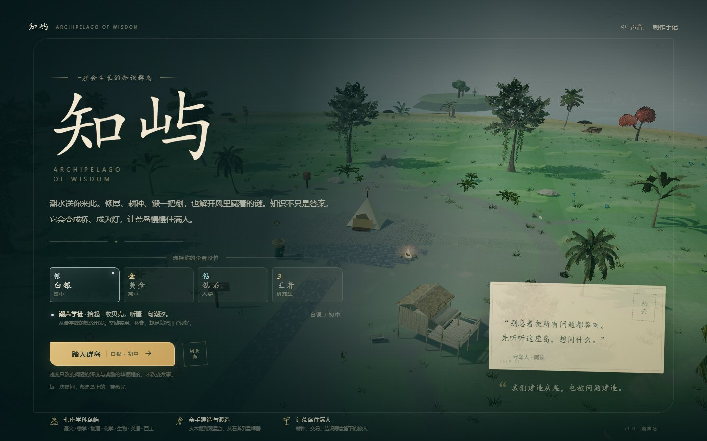
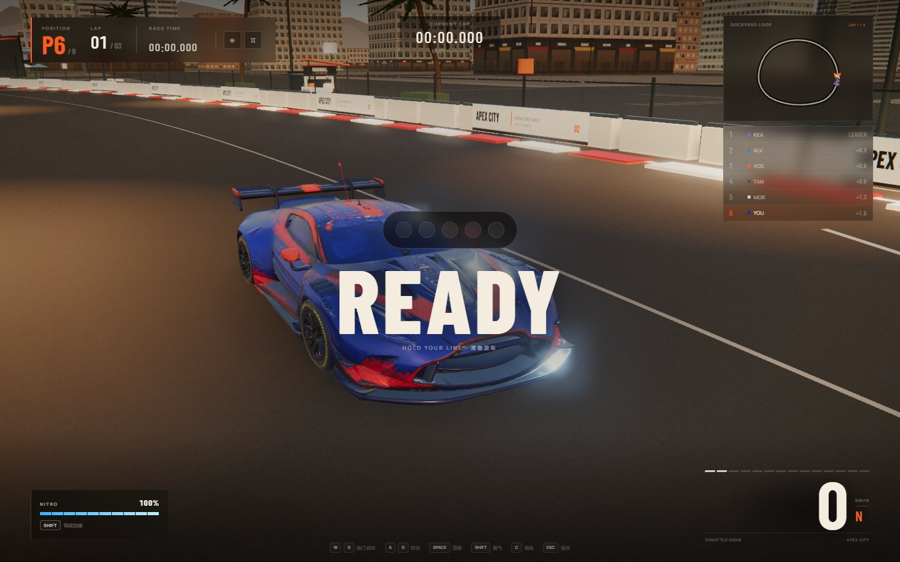
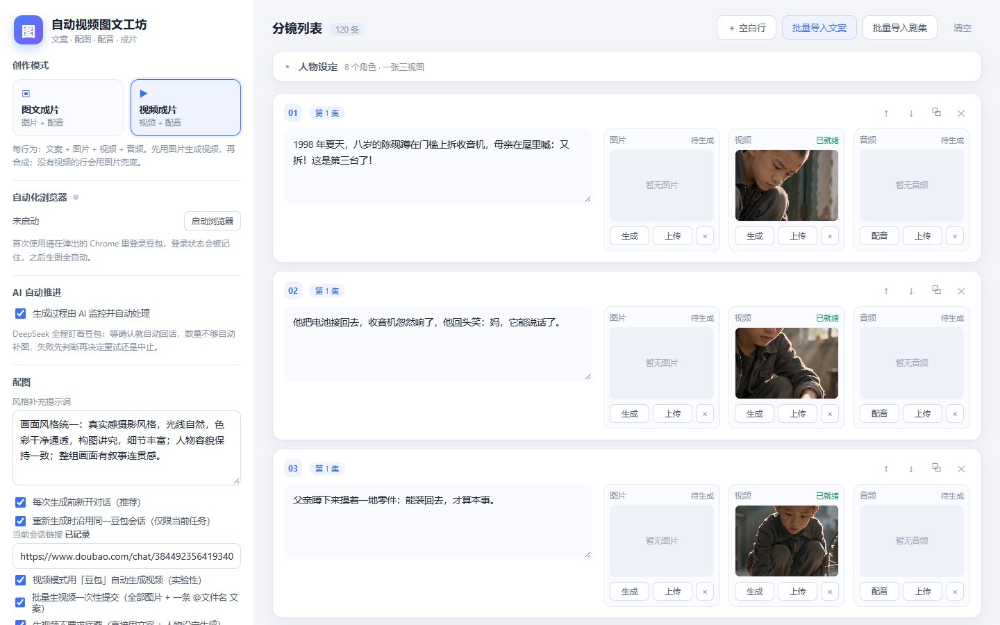
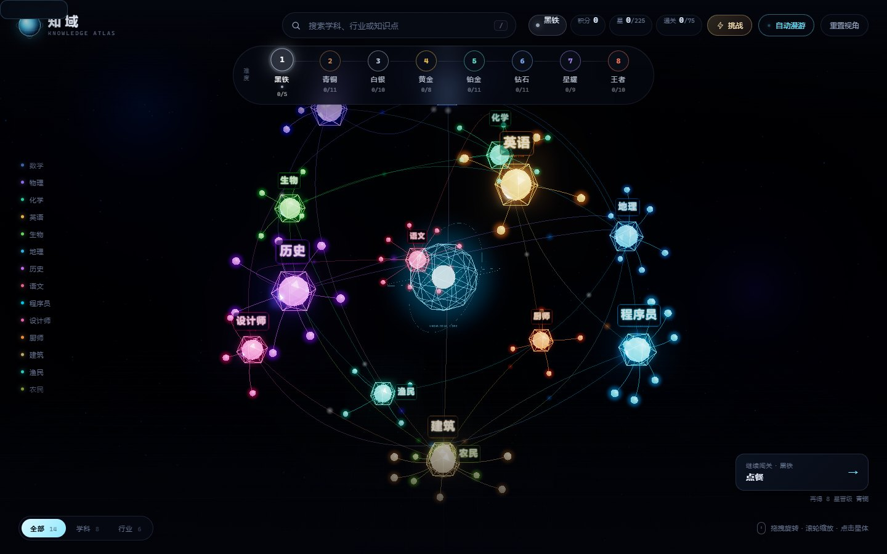

# AI 造物实验室

> 六个用 AI 一起做出来的小项目，外加一个只放作品的展馆。

这里每个项目都是完整可运行的：三款 3D 游戏、两套知识可视化、一个桌面自动化工具和一条本地视频流水线。源码全部开源，截图与说明在各自目录的 README 里。

## 项目

| 项目 | 预览 | 说明 | 技术栈 |
| --- | --- | --- | --- |
| [知屿 · 知识群岛](knowledge-archipelago/) |  | 在会生长的海岛上建造、耕种、答题。七座学科岛、程序化海岸与植被、手机横屏。 | three.js · Vite · WebGL2 |
| [知域 · 3D 知识图谱](knowledge-universe-3d/) |  | 14 个学科与行业、75 个知识点、8 个段位，板书式闯关与限时挑战。 | three.js · esbuild |
| [APEX CITY · 极速都市](official-demo-02-racing/) |  | 程序化城市赛车：四视图重建车模、5 台 AI 对手、四条赛道、漂移与氮气。 | three.js · GLSL · Web Audio |
| [批量提示词工作台](prompt-batch-studio/) |  | Windows 桌面工具：把「写需求 → 粘贴 → 等 AI 写完」整条队列自动化。 | Electron · UIAutomation |
| [苔溪镇 · Mossbrook Village](xiaozhen/) |  | 模块化中世纪小镇与程序化骨骼动画的第三人称漫步。 | three.js · GLTF |
| [自动视频图文工坊](zidongtuwen/) |  | 文案 → 配图 → 配音 → 字幕 → 成片，本地运行的短视频流水线。 | Python · Flask · Selenium · ffmpeg |
| [AI 造物馆](ai-showcase/) |  | 作品展示站：分类、搜索、PC / 手机截图画廊，支持访客提交作品（最多 8 张）。 | 原生 HTML / CSS / JS |

## 快速开始

每个项目都有独立的 README，下面是总览：

| 项目 | 启动 |
| --- | --- |
| knowledge-archipelago | `npm install && npm run dev` → http://localhost:5199 |
| knowledge-universe-3d | `npm install && npm run dev` → http://127.0.0.1:4280 |
| official-demo-02-racing | `npm install && npm run dev` → http://localhost:4173 |
| prompt-batch-studio | `npm install && npm start`（Windows + Node 18+） |
| xiaozhen | `npm install && npm start` → http://localhost:5173 |
| zidongtuwen | `pip install -r requirements.txt`，复制 `config.example.json` 为 `config.json` 填 Key，`python app.py` |
| ai-showcase | 直接打开 `index.html`，或 `python -m http.server 8899` |

## 目录

```
knowledge-archipelago/    3D 岛屿经营 + 知识试炼
knowledge-universe-3d/    3D 知识图谱与板书闯关
official-demo-02-racing/  程序化城市赛车
prompt-batch-studio/      Electron 批量提示词工作台
xiaozhen/                 3D 中世纪小镇漫步
zidongtuwen/              本地视频图文流水线
ai-showcase/              AI 作品展示站
```

## 关于仓库体积

仓库只保留源代码与运行时资源，以下内容通过 `.gitignore` 排除：

- `node_modules/`、`dist/` 等依赖与构建产物
- 3D 素材源包（`.zip`、`.blend`、`.fbx`、原始素材目录），只保留转换后的 GLB
- 运行数据、日志、浏览器配置、成片缓存
- 含 API Key 的本地配置（`zidongtuwen/config.json`，请从 `config.example.json` 复制）

## 提交新项目

1. 在根目录新建项目文件夹，补一个 README（介绍 / 玩法 / 技术栈 / 4 张截图）；
2. 截图统一放在 `screenshots/pc-1.jpg`、`pc-2.jpg`、`mobile-1.jpg`、`mobile-2.jpg`；
3. 在 `ai-showcase/data/projects.js` 里加一条作品数据，把截图复制到 `ai-showcase/assets/projects/<slug>/`；
4. 更新本 README 的项目表。

## 许可

MIT。各项目内引用的第三方美术素材遵循原素材包许可（见项目 README）。
