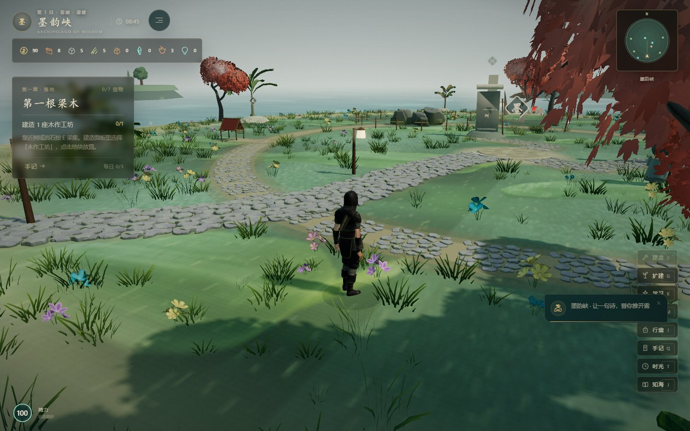
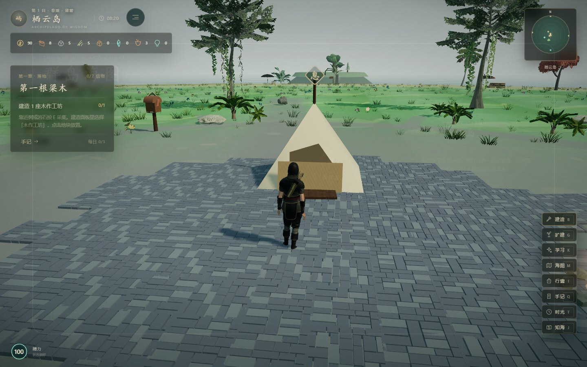
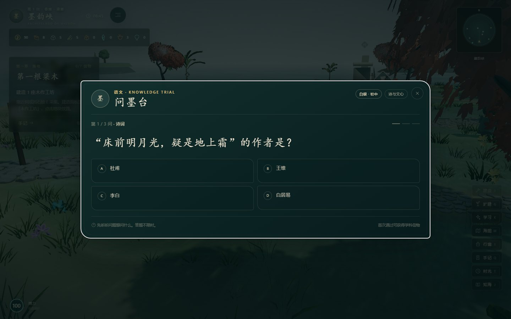
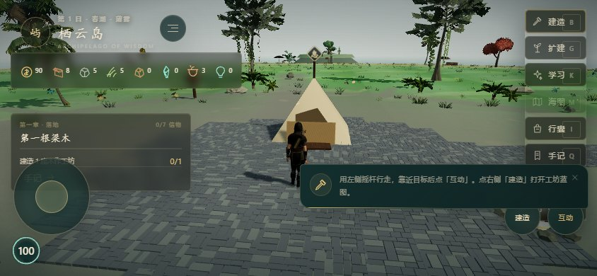
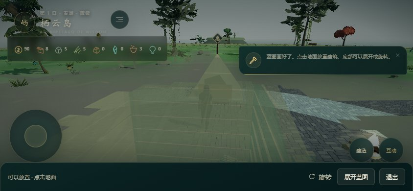

# 知屿 · 知识群岛

> 一座会生长的知识群岛。修屋、耕种、锻一把剑，也解开风里藏着的谜。

浏览器里的 3D 岛屿生活游戏：把模拟经营、建造、锻造与跨学科答题放进同一片海。

<table>
  <tr>
    <td width="50%"></td>
    <td width="50%"></td>
  </tr>
  <tr>
    <td></td>
    <td></td>
  </tr>
  <tr>
    <td></td>
    <td></td>
  </tr>
</table>

## 介绍

玩家继承一座只有旧帐篷和薄田的小岛，乘船前往七座学科岛，通过知识试炼获得信物、材料与图纸，再带回栖云岛，变成可以居住、耕种、远航的家园。岛屿不是静态背景：砍树、采石、开垦、建造都会改变地形与聚落，居民会搬进来，海岸线会随扩建一点点向海里生长。

v2.0「手作光」重做了操作与画面：底部常驻操作坞把「建造 / 扩建 / 学习」摆在拇指边，岛屿边缘立起扩张石碑，走过去按 `E` 就能填海；热带海岸接入棕榈、王棕、香蕉、蕨类与木栈桥；木纹、石纹、茅草、瓦片全部是运行时生成的程序化贴图；上千株草叶用 InstancedMesh 随风摆动，配合程序化环境贴图、轻量泛光与重写的水面。

## 玩法

- **岛屿经营**：伐木、采石、耕种、建造房屋与工坊，把荒岛扩成有居民的小镇。
- **知识试炼**：七座学科岛各有一条试炼线，答题通过后获得学科信物，解锁新的土地与图纸。
- **锻造与制作**：把材料做成工具、家具与船件，部分蓝图需要跨学科信物才能开启。
- **移动端适配**：手机打开自动横屏，标题页、HUD、对话与建造面板都使用横屏紧凑排版；设置里可切左手 / 右手，摇杆三档可调。
- **操作**：`W A S D` 移动，`E` 互动，`G` 扩建，`K` 学习，`M` 海图，`Esc` 关闭面板。

## 技术栈

- **Vite 5 + three.js 0.169**，原生 ES Modules，无前端框架。
- WebGL2 渲染：GLB 模型、程序化贴图（木 / 石 / 茅草 / 瓦 / 泥土）、InstancedMesh 植被、IBL 环境贴图、泛光、自定义多层水面与菲涅尔反射。
- 自研游戏层：状态机、localStorage 存档、交互提示、蓝图放置、碰撞与地形高度采样。
- 内容与代码分离：岛屿、配方、题库、对话都在 `src/data`，可用 `npm run validate` 校验。

## 运行

```bash
npm install
npm run dev      # http://localhost:5199
npm run build    # 产物在 dist/
```

## 目录

```
src/
  core/      引擎与通用系统
  engine/    渲染、地形、水面、后期
  game/      玩法：建造、耕种、锻造、试炼
  data/      岛屿、配方、题库、对话
  ui/        HUD、面板、对话
public/models/  转换后的 GLB 资源
```

## 许可

MIT
