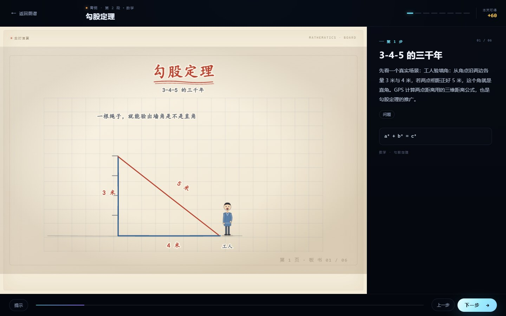
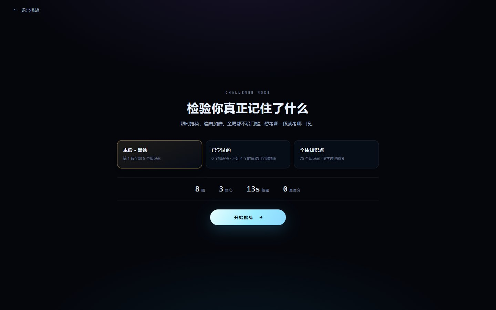
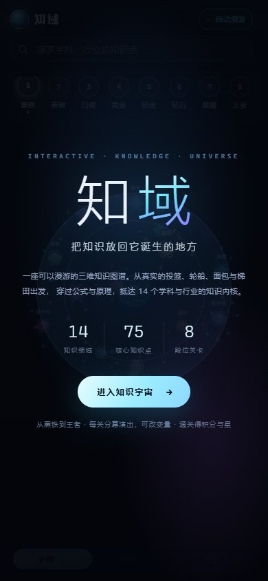
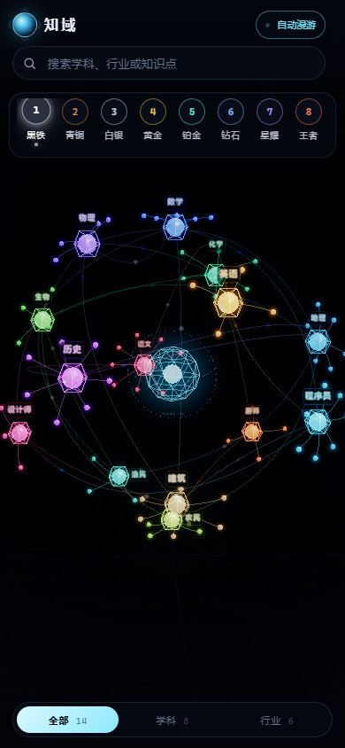

# 知域 · 3D 知识图谱

> 一座可以「闯关」的知识图谱。14 个学科与行业、75 个知识点、8 个段位，从青铜到王者。

每个知识点只有一种讲法：**板书**。点开节点，直接进入一块纸白板——黏土贴片加手写标注，按「上一步 / 下一步」一笔一笔往下画，最后拼成一张完整的知识图。

<table>
  <tr>
    <td width="50%"></td>
    <td width="50%"></td>
  </tr>
  <tr>
    <td></td>
    <td></td>
  </tr>
  <tr>
    <td></td>
    <td></td>
  </tr>
</table>

## 介绍

知域把「知识」画成一片可以漫游的星图。数学、物理、化学、生物、历史、语文、英语、地理，再加上程序员、设计师、厨师、建筑、农民、渔民六个行业方向，每个学科是一颗主星，知识点是它周围的小行星，连线表示前置关系。点进去不是一段长文，而是一块会逐步生长的板书：数学走「问题 → 旧办法 → 谁提出 → 公式 → 代入现实 → 边界」，历史走时间线与因果，语文按起承转合四格展开，行业讲「麻烦 → 代价 → 方法 → 操作 → 结果」。

长板书支持 10–16 步、分 3 页，前面画过的不擦掉，最后能看见完整推导。所有段位和关卡都可以直接进入，不设解锁；星数只影响段位徽章与积分。

## 玩法

- **闯关板书**：点击知识点，用「上一步 / 下一步」逐格揭示；部分关卡有检查点，答对额外得星。
- **段位系统**：黑铁 → 青铜 → 白银 → 黄金 → 铂金 → 钻石 → 星耀 → 王者，按累计星数晋级。
- **挑战模式**：8 题、13 秒一题、3 颗心、连击倍率最高 2.4×，结束后给 S/A/B/C 评级与错题复盘。
- **深链接**：`#enter`、`#lesson=chinese-poem-jingye`、`#tier=4`、`#challenge` 可以直接跳到指定位置。
- **操作**：拖拽旋转、滚轮缩放；手机端单指旋转、双指缩放，节点与筛选栏重新排布。

## 技术栈

- **esbuild + three.js 0.169**，零运行时框架，构建后可直接打开 `index.html`。
- 3D 星图：自研球面布局、力导向连线、节点高亮与镜头缓动，InstancedMesh 承载小行星。
- 板书引擎：数据驱动的分步脚本，黏土贴片 + 手写标注 + SVG/DOM 混排，支持分页与检查点。
- 进度存在 `localStorage`，挑战模式有独立计时器、连击倍率与错题记录。

## 运行

```bash
npm install
npm run dev      # http://127.0.0.1:4280
npm run build    # 生成 dist/ 与可直接打开的 index.html
```

## 目录

```
src/
  graph/     星图布局、连线、镜头
  game/      关卡、板书、挑战、进度
  data/      14 个学科与 75 个知识点内容
  styles/    界面与板书样式
assets/boards/  板书插图
```

## 许可

仅限个人学习、研究与技术交流使用，**不可用于商业用途**。商业授权请联系作者 QQ 993739647，详见仓库根目录 [LICENSE](../LICENSE)。
