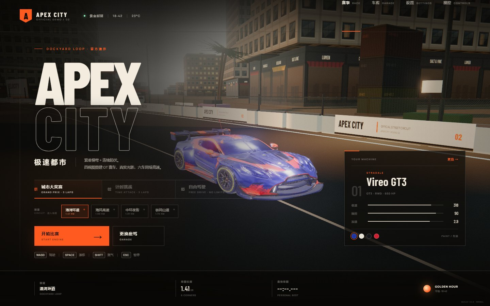
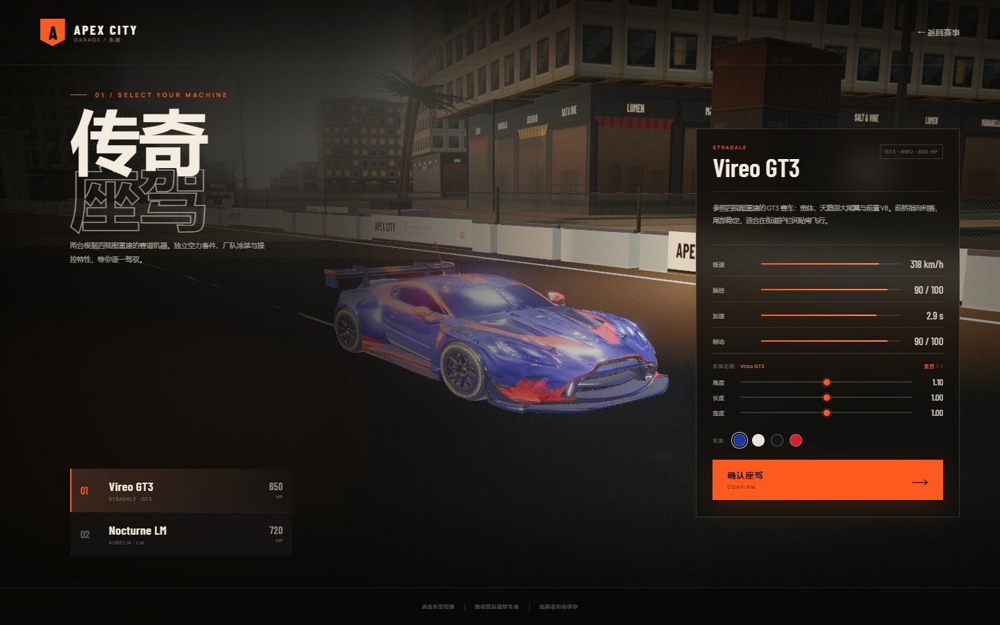
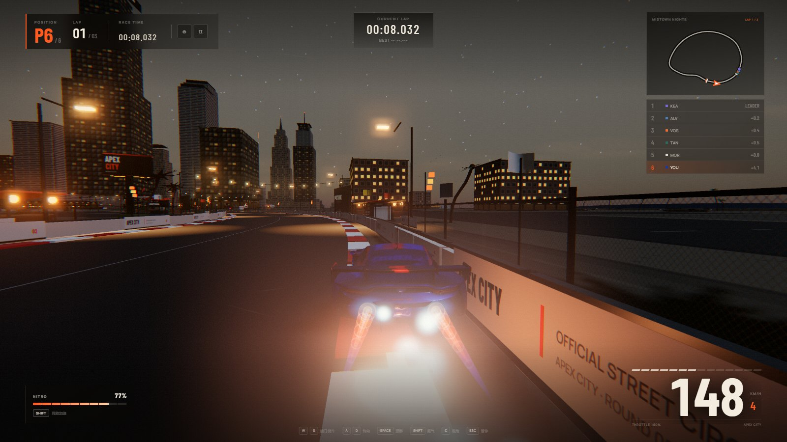
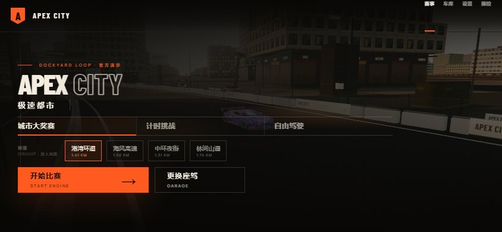
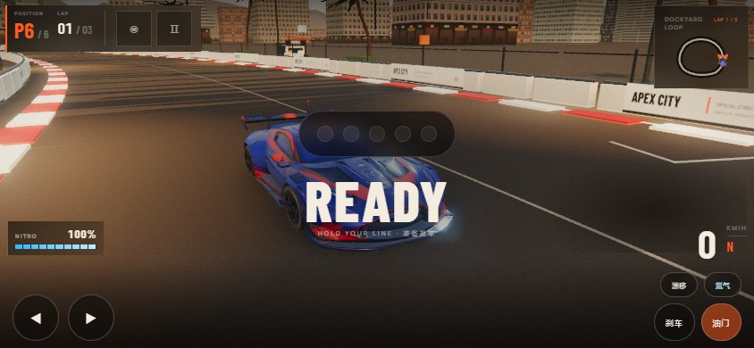

# APEX CITY · 极速都市

> 黄金时刻的港湾街道。两台依据四视图重建的 GT 赛车、程序化城市、六车同场竞速。

浏览器里的完整 3D 城市赛车游戏：三条模式、四条赛道、可漂移可氮气，双击 `index.html` 就能玩。

<table>
  <tr>
    <td width="50%"></td>
    <td width="50%"></td>
  </tr>
  <tr>
    <td></td>
    <td></td>
  </tr>
  <tr>
    <td></td>
    <td></td>
  </tr>
</table>

## 介绍

APEX CITY 是一座程序化生成的滨海都市：街区、楼宇、店面、路灯、看台、发车门架、护栏与广告牌都由代码铺设，没有任何外部地图数据。比赛在黄昏的港湾街道发车，5 台 AI 对手与你同场，3 圈定胜负；也可以切到计时挑战刷个人最快圈，或在自由驾驶里沿滨海公路慢慢开。

两台赛车依据四视图重建为真实 GLB 模型：蓝色厂队 GT3「STRADALE Vireo GT3」与白色耐力原型「AURELIA Nocturne LM」，各约 12 万三角面、带 PBR 贴图，灯组、尾翼、进气口、扩散器、轮毂、号码与涂装都烘焙在模型里，引擎侧只额外补刹车灯辉光、车底阴影与换色着色器。

## 玩法

- **城市大奖赛**：静态发车，5 台 AI 对手，3 圈定胜负。
- **计时挑战**：单走赛道，成绩保存在本地。
- **自由驾驶**：没有对手、没有计时，沿滨海街道自由驾驶。
- **四条赛道**：港湾环道 1.41 km、海风高速 1.50 km、中环夜街 1.31 km、林间山道 1.74 km，各有独立地形、海岸线与街区。
- **操作**：`W/↑` 油门，`S/↓` 刹车倒车，`A D/← →` 转向，`Space` 手刹漂移（为氮气充能），`Shift` 氮气，`C` 切视角，`R` 回赛道，`P` 照片模式；支持标准 Xbox 手柄。
- **移动端**：横屏触控，左下方向、右下油门 / 刹车 / 氮气。

## 技术栈

- **esbuild + three.js 0.169**，纯前端，无后端依赖。
- 程序化城市与赛道：样条中心线生成路面、路缘、护栏、发车区；建筑与设施用合并网格 / InstancedMesh 控制 draw call。
- GLB PBR 车模 + 四视图重建流程；AI 对手复用同款车体并做主色区域替换。
- GLSL 后期：泛光、色调映射、速度感；程序化 Web Audio 引擎声；AABB / 胶囊碰撞与赛道边界约束。

## 运行

```bash
npm install
npm run dev      # http://localhost:4173
npm run build    # 构建后可直接双击 index.html
```

## 目录

```
src/
  city.js       程序化城市与建筑
  track.js      赛道样条、路面、护栏
  car.js        车辆物理与程序化车身兜底
  carasset.js   GLB 车模加载与换色
  race.js       比赛流程、AI、计时
  post.js       后期处理
assets/models/  两台赛车的 GLB
assets/cars/    四视图参考图
```

## 许可

仅限个人学习、研究与技术交流使用，**不可用于商业用途**。商业授权请联系作者 QQ 993739647，详见仓库根目录 [LICENSE](../LICENSE)。
