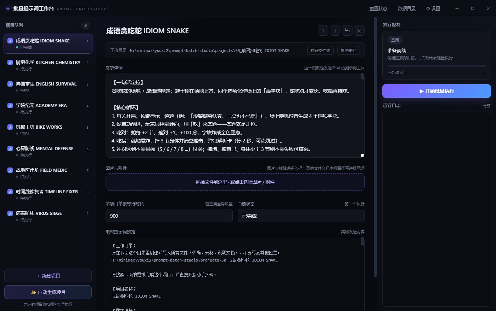
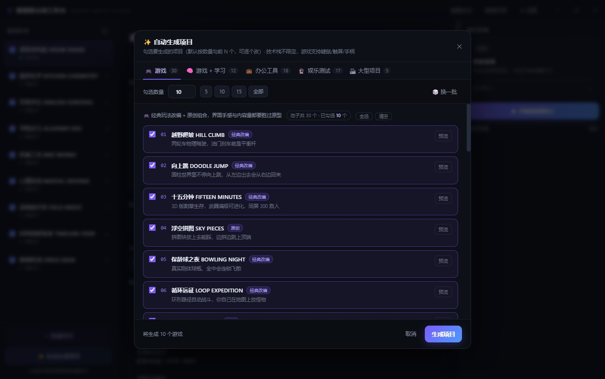
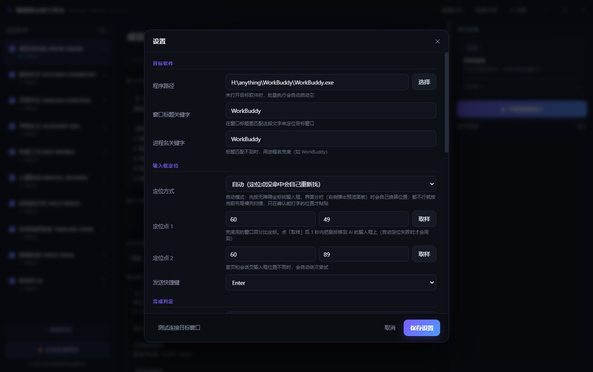
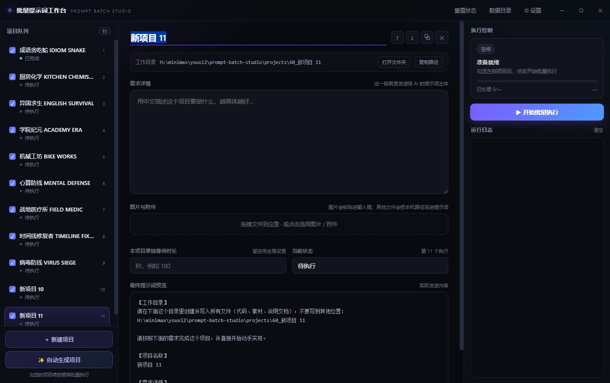
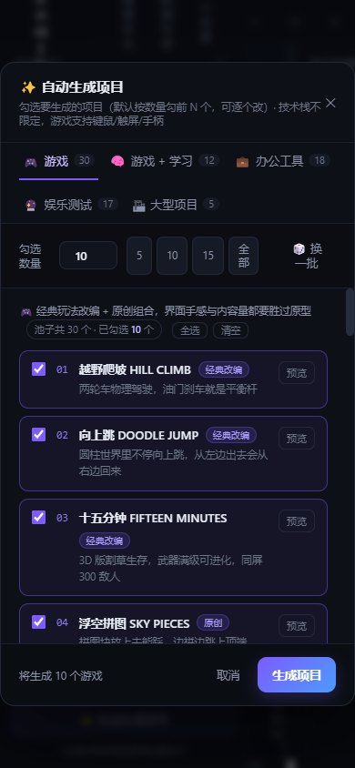
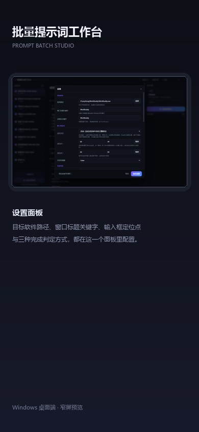

# 批量提示词工作台 · Prompt Batch Studio

> 把「写需求 → 打开 AI → 粘贴 → 等它写完 → 再写下一个」这套重复动作自动化。

在软件里建 N 个项目，每个项目写清需求、挂上图片和附件；点一次「开始批量执行」，它会自动打开 / 激活目标 AI 客户端（默认 WorkBuddy），把提示词填进输入框、按回车发送，等 AI 输出完成后自动开始下一个，直到整条队列跑完。

<table>
  <tr>
    <td width="50%"></td>
    <td width="50%"></td>
  </tr>
  <tr>
    <td></td>
    <td></td>
  </tr>
  <tr>
    <td></td>
    <td></td>
  </tr>
</table>

## 介绍

这是一个面向「批量造项目」场景的 Windows 桌面工具。左侧是项目队列，右侧是当前项目的需求详情、附件、单项目超时、实时日志与执行控制。每个项目自动分配独立工作目录，路径会写进提示词，AI 直接产在那个目录里；图片会作为剪贴板图片粘贴进输入框，其他附件把本机路径写进提示词。

最麻烦的「AI 什么时候写完」有三种判定：画面静止检测（定时截屏比对窗口，连续 N 秒基本不变即认为完成）、固定时长等待、手动确认。输入框定位有四重保险：先读系统无障碍树拿真实矩形，再退回手动定位点，再按当前布局横向扫描，点击后还要用「粘贴 → 全选复制 → 回读剪贴板」确认这个位置真的能吃进文字，所以右侧弹出预览面板、窗口尺寸变化时不需要重新取样。

## 功能

- **项目管理**：新建 / 复制 / 删除 / 上下移动，标题 + 需求详情。
- **独立工作目录**：每个项目自动分配文件夹，路径写进提示词。
- **自动生成项目**：游戏 / 游戏 + 学习 / 办公 / 娱乐 / 大型项目五个方向共 82 个原创需求，选数量一次生成 N 个。
- **素材随项目走**：支持拖拽图片与附件，附件自动复制到数据目录。
- **批量队列**：勾选项目，一键按顺序执行；进度、当前项目、倒计时、实时日志，可暂停 / 继续 / 跳过 / 停止。
- **提示词模板**：`{{title}}` `{{details}}` `{{attachments}}` `{{index}}` `{{total}}`。
- **数据本地存储**：不联网、不上传，配置与队列都在本机。

## 技术栈

- **Electron 33 + 原生 HTML / CSS / JavaScript**，无前端框架。
- Node 侧：`fs` 管理项目与附件、`child_process` 调 PowerShell 脚本、窗口枚举与激活。
- Windows UI 自动化：UIAutomation 无障碍树读取输入框矩形、剪贴板读写校验、截屏比对判定完成。
- 零依赖渲染层：列表虚拟滚动、拖拽排序、Toast、模态面板。

## 运行

```bash
npm install
npm start        # Windows + Node.js 18+
```

首次运行自动创建数据目录。默认目标软件是 WorkBuddy，可在「设置」里改成任意桌面 AI 客户端。

## 目录

```
main.js          Electron 主进程：窗口、IPC、队列、UI 自动化
preload.js       安全桥接
src/             渲染层：界面、预设需求、状态管理
scripts/         PowerShell：窗口定位、截屏、等待空闲
```

## 许可

MIT
