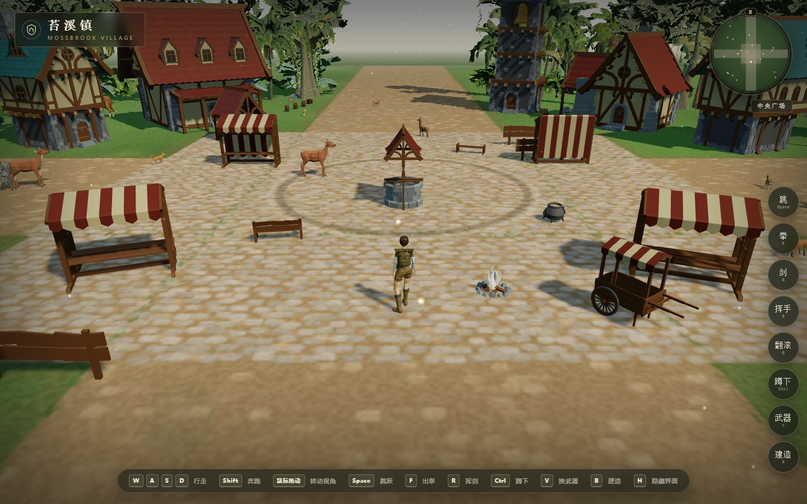
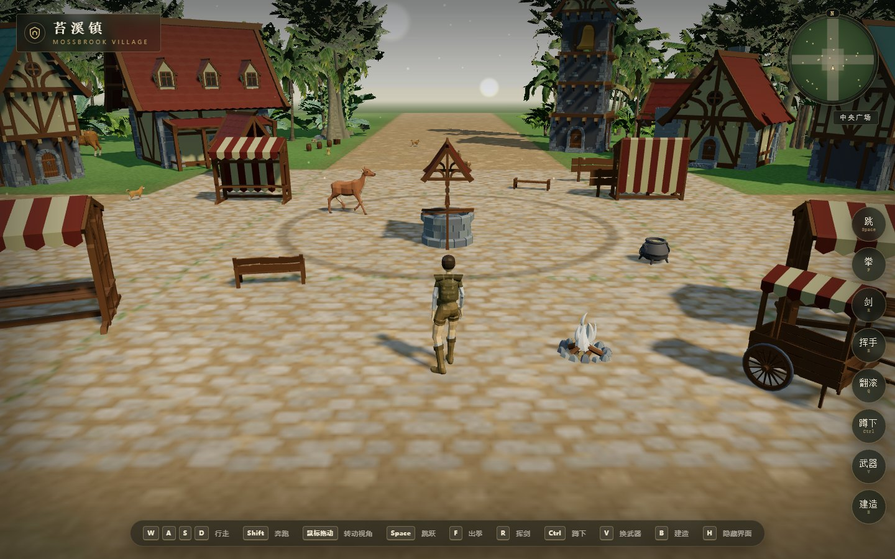
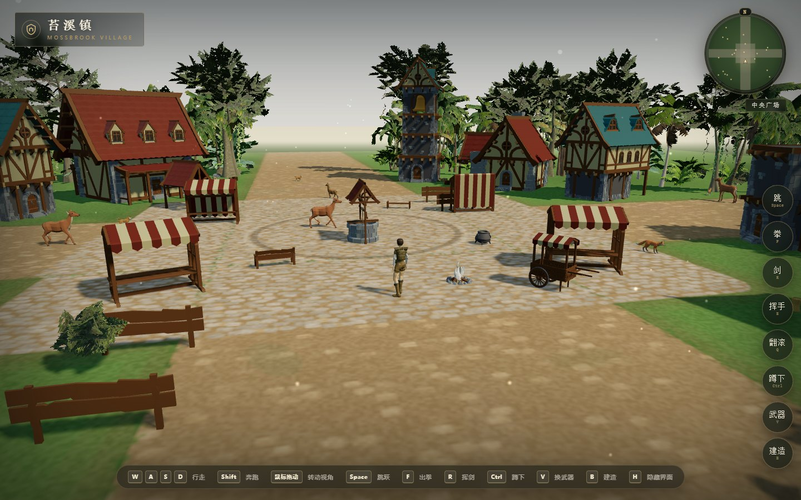
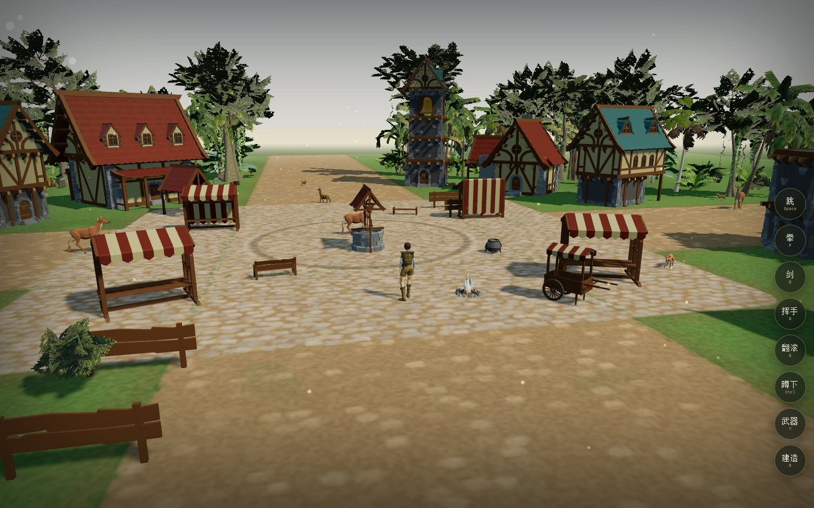
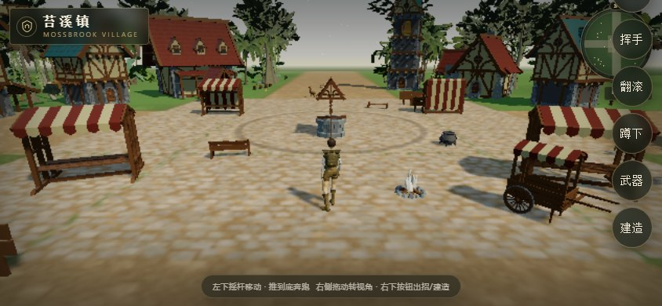
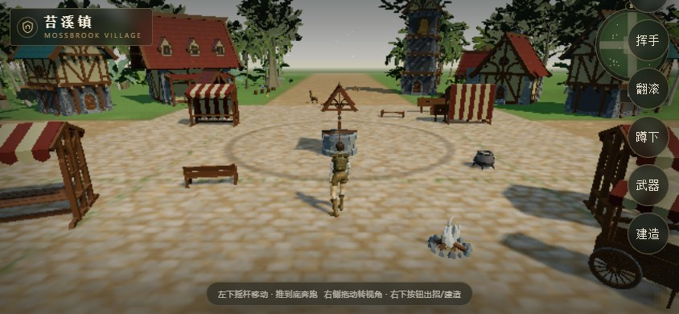

# 苔溪镇 · Mossbrook Village

> 用模块化中世纪素材拼出的小镇，和一个靠代码驱动的第三人称漫步者。

浏览器里的 3D 小镇漫步：石井、集市、客栈、钟楼、鹿群与雨林边缘，走进去就能逛。

<table>
  <tr>
    <td width="50%"></td>
    <td width="50%"></td>
  </tr>
  <tr>
    <td></td>
    <td></td>
  </tr>
  <tr>
    <td></td>
    <td></td>
  </tr>
</table>

## 介绍

苔溪镇是一个「没有任务」的小镇。广场中央是一口石井，四周是条纹遮阳棚的摊位、木栅栏、货车、篝火与闲逛的鹿；街道把广场、客栈、钟楼和北门连起来，边缘接着雨林。玩家可以在里面随意走，角色会被房屋、栅栏、货车、木箱和树木挡住，可以贴着墙面滑动；右上角小地图实时显示位置与所在区域（中央广场、北门农舍、雨林边缘……）。

小镇不是一整块模型，而是用模块化墙体、屋顶、门窗、栅栏、摊位拼装出来的：每栋房子由布局数据决定尺寸、层数、屋顶样式与门窗位置，换一套数据就是另一座镇。角色使用低多边形冒险者模型，行走、奔跑、站立呼吸全部是代码驱动的程序化骨骼动画，不依赖预制动画片段。

## 玩法

- **自由漫步**：`W A S D` / 方向键移动，`Shift` 奔跑，按住鼠标拖动旋转镜头，滚轮拉近拉远。
- **区域探索**：穿过广场、街道、客栈门口、北门与雨林边缘，小地图会显示当前区域。
- **碰撞与贴墙**：房屋、栅栏、货车、木箱、树木都有碰撞体，可以沿墙滑动。
- **界面**：`H` 显示 / 隐藏界面；右侧动作栏与底部按键提示会随设备切换。
- **移动端**：横屏触控，左下摇杆移动，右侧拖动视角。

## 技术栈

- **three.js 0.169 + GLTFLoader**，零构建工具，纯 ES Modules。
- 模块化场景拼装：墙体 / 屋顶 / 门窗 / 栅栏按布局数据组合，InstancedMesh 复用高频道具。
- 程序化骨骼动画：按骨骼别名表适配不同 Humanoid 骨架，代码计算行走、奔跑、呼吸与转身。
- 碰撞：AABB / OBB 混合检测 + 贴墙滑动，第三人称相机避障与阻尼跟随。
- 零依赖 Node 静态服务器（`game/server.js`，端口 5173）。

## 运行

```bash
npm install
npm start        # http://localhost:5173
```

> 不能直接双击 `game/index.html`，ES Module 与 glTF 资源需要 HTTP 服务。

## 目录

```
game/
  index.html     页面与 HUD
  styles.css     界面样式
  server.js      零依赖静态服务器
  src/
    main.js      渲染器、加载、相机、输入、小地图、主循环
    town.js      小镇布局、模块化房屋拼装、碰撞体
    player.js    角色骨骼、程序化动作、移动
    world.js     地形、植被、动物
    animals.js   鹿群行为
  assets/        GLB 模型与贴图
```

## 素材说明

小镇与角色基于 Quaternius 的 Medieval Village / Modular Character 素材包改造，仓库只保留运行所需的 GLB，原始素材包与 .blend 源文件未上传。

## 许可

仅限个人学习、研究与技术交流使用，**不可用于商业用途**。商业授权请联系作者 QQ 993739647，详见仓库根目录 [LICENSE](../LICENSE)。

美术素材遵循原素材包许可。
