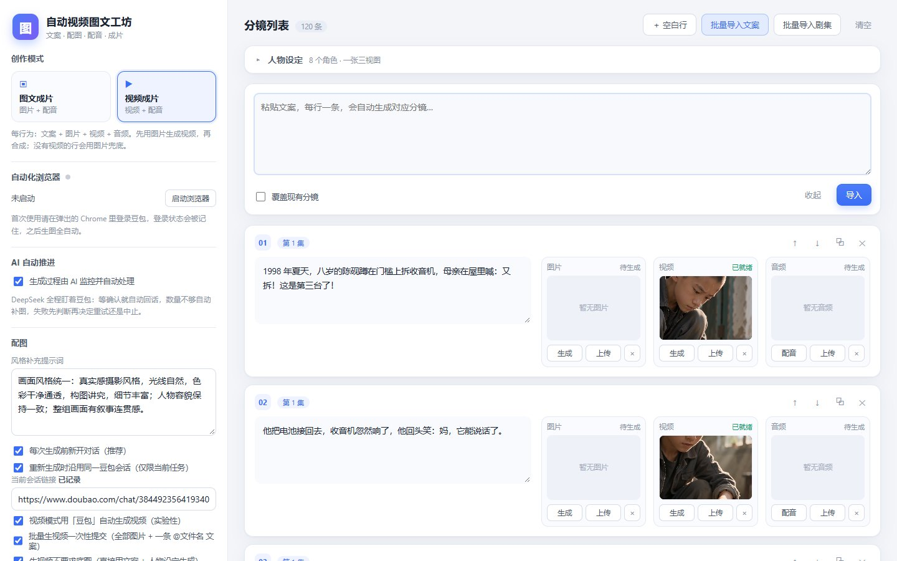

# 自动视频图文工坊

> 把一段段文案变成成片：每行文案 → 配图（自动化浏览器）→ 配音（DashScope）→ 字幕 / 片头 → 拼接成片（ffmpeg）。

本地运行的网页版流水线，不生成文案、不发布，只负责把素材与语音拼成视频。

<table>
  <tr>
    <td width="50%"></td>
    <td width="50%"></td>
  </tr>
  <tr>
    <td></td>
    <td></td>
  </tr>
</table>

## 介绍

自动视频图文工坊是一套面向口播 / 图文短视频的本地生产工具。左边选模式（图文成片 / 视频成片），右边是分镜列表：每一行是一段文案，配一张图、一段配音和一个视频位。点「一键全流程」，程序会拉起独立的 Chrome 窗口，用已登录的豆包账号逐条生成配图 / 视频；再用 DashScope 的 CosyVoice 合成配音，按字幕时间轴切片头、字幕与转场，最后用 ffmpeg 拼接成片。

它不调用爬虫接口，而是复用真实浏览器里的登录态：首次使用在弹出的 Chrome 里登录一次豆包（和即梦），之后所有任务都在这个独立配置目录里跑，不影响日常浏览器。AI 推进会盯着对话，确认回复完成再取图；数量不够会按重试策略补生成，失败先判断是重试还是中止。

## 功能

- **两种模式**：图文成片（图片 + 配音）与视频成片（图片 + 视频 + 配音）。
- **分镜列表**：每行一段文案，可单独生成 / 上传 / 覆盖图片、视频与音频。
- **批量导入**：粘贴整段文案按行拆分，或导入剧集文件逐集生成。
- **一键全流程**：生图 → 配音 → 字幕 / 片头 → 拼接，任务日志实时滚动。
- **AI 推进**：DeepSeek 全程盯豆包，自动判断回复完成、自动补图、失败重试。
- **成片预览**：内置播放器与任务状态，可中断、可跳过、可重跑单条。
- **本地优先**：所有素材、配置、成片都在本机 `data/` 下，不上传云端。

## 技术栈

- **Python 3 + Flask**：本地 HTTP 服务与控制台日志总线。
- **Selenium + Chrome**：独立 profile 复用豆包 / 即梦登录态，抓取生成结果。
- **DashScope CosyVoice**：TTS 配音；**ffmpeg**：字幕烧录、片头、转场与拼接。
- 原生 HTML / CSS / JavaScript 前端，无框架；任务队列与状态机在 `core/pipeline.py`。
- DeepSeek API：生成过程中的自动判断与补图决策。

## 运行

```bash
pip install -r requirements.txt
# 复制配置模板并填入自己的 Key
copy config.example.json config.json
python app.py            # 或双击 启动.bat
```

打开 `http://127.0.0.1:8879`。首次使用点「启动浏览器」，在弹出的 Chrome 里登录豆包；需要视频时再登录即梦。系统需要安装 **ffmpeg** 并加入 PATH。

## 目录

```
app.py            Flask 入口与路由
core/             配置、浏览器、流水线、TTS、字幕、拼接
web/              前端页面与脚本
config.example.json  配置模板（API Key 需自行填写）
```

## 说明

`config.json` 含 API Key，已在 `.gitignore` 中排除；请从 `config.example.json` 复制后填写自己的密钥。

## 许可

MIT
